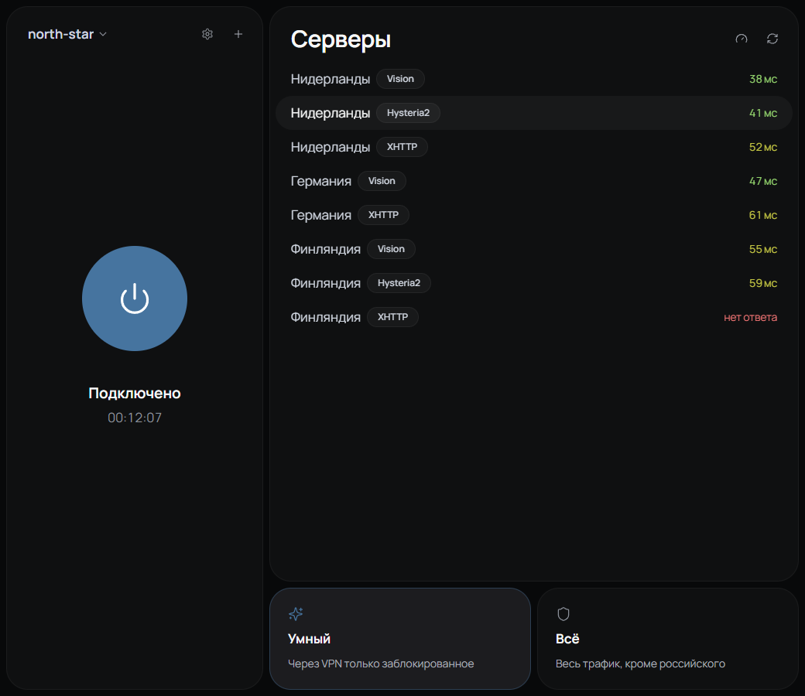

# Monolit

VPN-клиент для Windows на ядре Xray. Через VPN идёт только то, что без него не открывается, остальное работает напрямую.



## Что умеет

- Подписки: monolit proxy, Remnawave и любые другие — списком ссылок или готовым конфигом Xray. Протоколы VLESS (Vision, Reality, XHTTP, WS, gRPC), Hysteria2, Trojan, VMess, Shadowsocks
- Умный режим: клиент сам замечает, что сайт не открывается напрямую, и пускает его через VPN. Причина записывается, список можно править
- Режим «Всё»: весь трафик через VPN, кроме российского
- Выбор пути для программы или сайта — через VPN или напрямую (на экране «Соединения» видно, что куда идёт)
- Блокировка рекламы
- Работает рядом с zapret
- Замер задержки серверов и переключение в одно нажатие
- Обновляется сам из релизов этого репозитория

## Установка

Скачайте `monolit.exe` из [последнего релиза](https://github.com/rawsense/monolit-client/releases/latest) и запустите. При первом запуске Windows один раз спросит права администратора — они нужны для сетевого адаптера. Программа ставится в `Program Files`, дальше запускается без вопросов.

Нужны Windows 10 или 11 и Microsoft Edge WebView2 (в Windows 11 он уже есть).

Удалить можно через «Приложения» в настройках Windows. Настройки и подписки удаляются отдельно, по вопросу при удалении.

## Сборка

Нужны Go и [go-winres](https://github.com/tc-hib/go-winres).

```powershell
.\build.ps1
```

Тесты:

```bash
go test -timeout 120s ./core ./windows
```

## Что внутри

Вся логика — в `core/`: подписки, конфиг ядра, маршруты, умный режим, настройки и интерфейс окна (`core/web`). Она общая для всех систем; в `windows/` — только то, чем отличается Windows: окно, трей, виртуальная сетевая карта, системный прокси, установка. Ядро Xray и сетевой стек gVisor лежат в `third_party/` с правками, список чужих компонентов и их лицензий — в [THIRD_PARTY.md](THIRD_PARTY.md).

Файл пока не подписан, поэтому Windows может показать предупреждение при запуске.

## Обратная связь

Об ошибках и идеях пишите в [Issues](https://github.com/rawsense/monolit-client/issues). К отчёту об ошибке желательно приложить журнал (кнопка в настройках) и описание, что делали — так исправить получится быстрее.

## Лицензия

[GPL-3.0](LICENSE)

Шрифт с флагами стран `core/web/brand/flags.woff2` — Twemoji Country Flags из [country-flag-emoji-polyfill](https://github.com/talkjs/country-flag-emoji-polyfill) (MIT); рисунки флагов — [Twemoji](https://github.com/twitter/twemoji), CC-BY 4.0. Сервер AmneziaWG в ядре — [amneziawg-go](https://github.com/amnezia-vpn/amneziawg-go) (MIT), копия в `third_party/amneziawg-go`.
